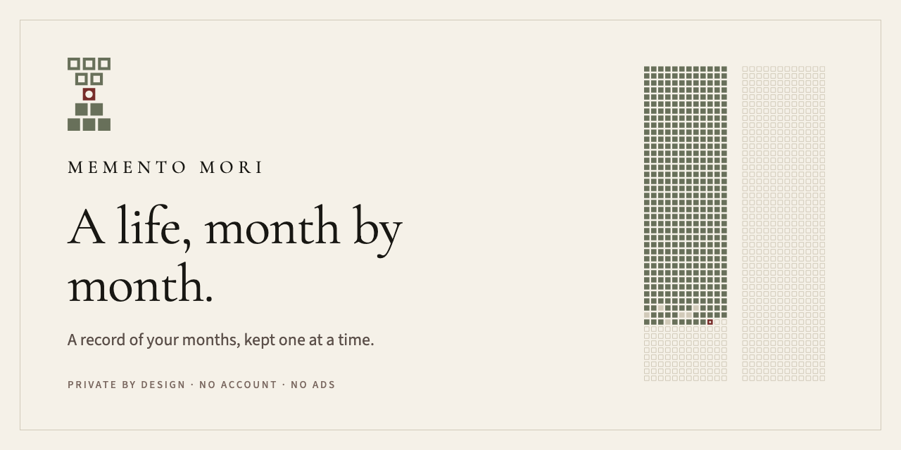
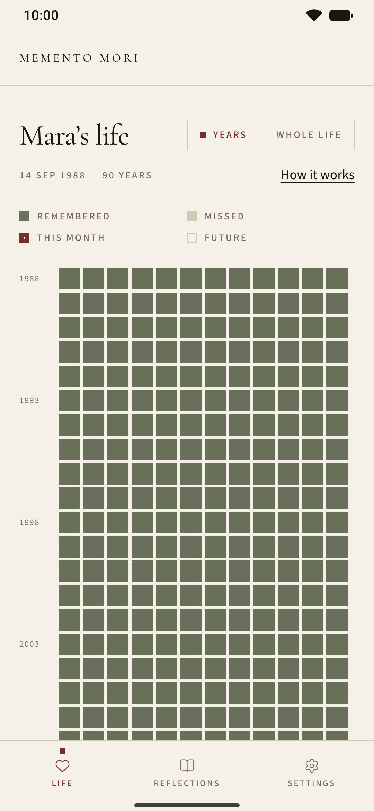
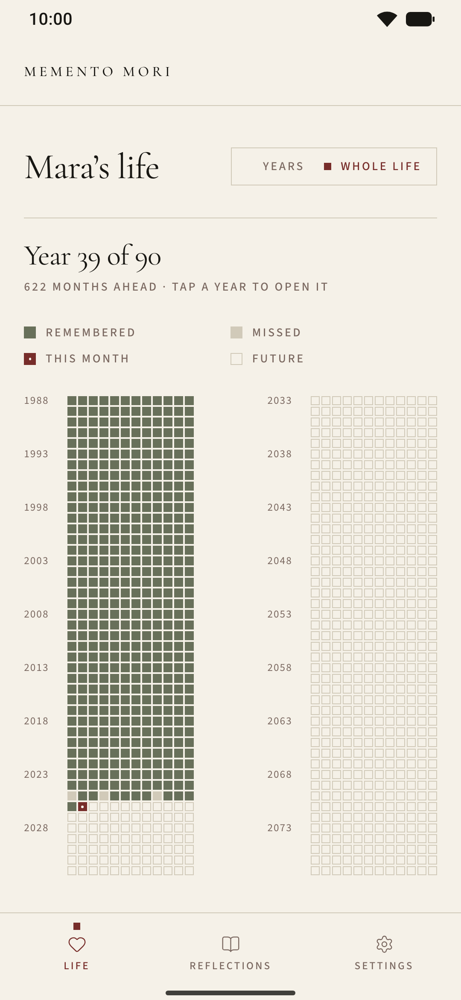
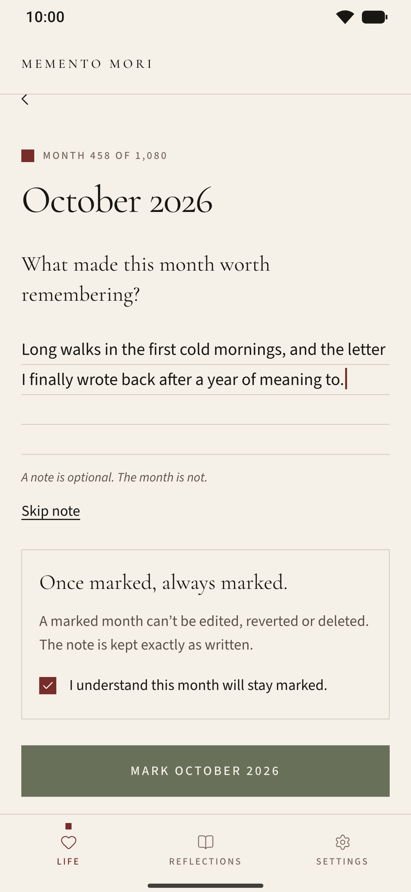
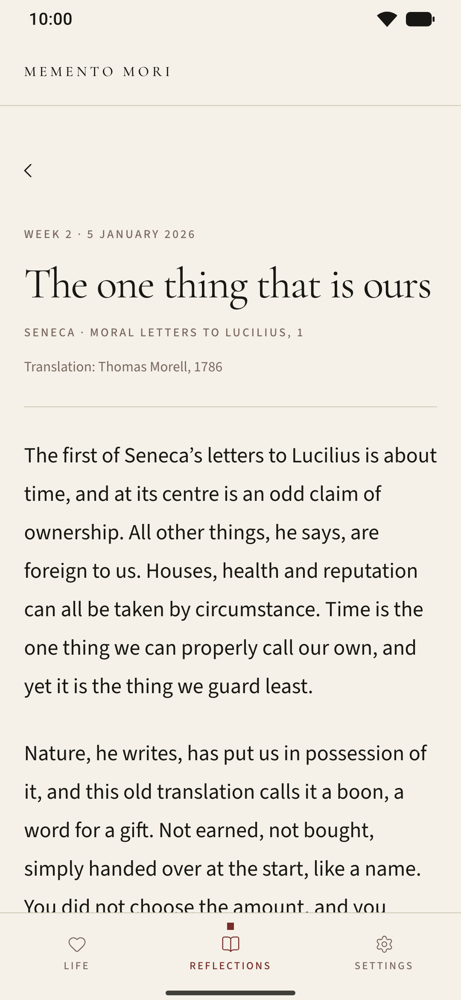

<b>English</b> · <a href="README.pt-BR.md">Português</a>

  

  <i>A record of your months, kept one at a time. Mark each month once. Keep what made it worth remembering.</i>

  <a href="https://github.com/gabrielsanttana/mementomori/releases/latest"><b>Download the preview APK</b></a>
  &nbsp;·&nbsp; Android 7.0 or newer &nbsp;·&nbsp; Coming to Google Play
   
  <a href="https://gabrielsanttana.github.io/mementomori/">gabrielsanttana.github.io/mementomori</a>

<table align="center">
  <tr>
    <td align="center"> YEARS</td>
    <td align="center"> WHOLE LIFE</td>
    <td align="center"> MARKING A MONTH</td>
    <td align="center"> THE WEEKLY REFLECTION</td>
  </tr>
</table>

---

## Why "memento mori"

*Memento mori* is Latin for "remember that you will die". It can sound grim at first, but it was
never meant to frighten. It was a way to bring the present into focus. The idea is older than the
phrase: Socrates, in Plato's *Phaedo*, called philosophy a practice for dying, and the Stoics after
him made it a daily exercise.

Seneca, in his letters and in *On the Shortness of Life*,
argued that life is long enough for anyone who knows how to use it; Marcus Aurelius returned to
the thought again and again in the *Meditations*; Epictetus gave it to his students plainly:

> *"Let death and exile and every other thing which appears dreadful be daily before your eyes;
> but most of all death: and you will never think of anything mean nor will you desire anything
> extravagantly."*
>
> Epictetus · Encheiridion, 21 · Translation: George Long, 1877

It lived on in Christian contemplation ("So teach us to number our days"), in the vanitas still
lifes that set an hourglass beside the good things on a table, and in Montaigne, who hoped death
would find him "planting my cabbages". The point is the same throughout: remembering that time
ends is a way to value it, not to fear it.

**A life on one page.** Counted in days, a life runs past thirty thousand. Counted in months,
ninety years is 1,080 squares, few enough to be seen whole. Life calendars such as Tim Urban's
"Your Life in Weeks" (Wait But Why, 2014) showed how much that one picture can say; Memento Mori
draws it in months, so each square can hold one mark and a few words, written only once.

<!-- OPTIONAL, for Gabriel: one or two sentences of your own on why you made this app. Leave it out if you prefer. -->

**What it is not**

- **Not a countdown.** Nothing ticks down, and nothing is predicted. The grid simply ends at the
  span you choose.
- **Not a habit tracker.** No streaks, no scores, no goals to hit.
- **Not built on guilt.** A missed month is simply missed. It is never shamed, and it stays open.

It is a quiet way to notice the time you are given, and to keep what made each month worth
remembering.

## The grid

Your life, drawn as months: one row for each year, twelve squares to a row. The grid begins at
your birth and ends at the span you choose, ninety years unless you set another. Each square is
one month of your life, and one of them is always the month you are living now.

| | Month | What it means |
| :-: | --- | --- |
|  | **Remembered** | A month you marked, with or without a note. The months before your record began are filled when you open it. |
|  | **Missed** | A past month left unmarked. It stays open; you can come back to it whenever you are ready. |
|  | **This month** | The month you are in, waiting to be marked. |
|  | **Future** | The months still ahead. |

## Marking a month

Once a month, open the square for the month you are in and answer a single question: *what made
this month worth remembering?* Keep a short note, or mark the month without one. A note is
optional. The month is not.

**Written once, as in ink.** A marked month can't be edited afterwards, and that is the intention.
You pause, choose what this month should be remembered for, and write it once, the way an entry
goes into a ledger in ink; knowing there is no second draft gives those few words their weight.
What stays is what you chose to keep at the time, not a version polished later. Once marked,
always marked.

## Two views

- **Years.** The board opens on your years, one row at a time, with the current year in sight and
  a quiet tally beneath: remembered, missed, still ahead.
- **Whole life.** Every year on one screen, without scrolling, under a single line that says where
  you are, such as "Year 39 of 90". Pinch in on the years view to get there, and tap a year to open
  it.

## The weekly reflection

A few minutes for what gives the months their meaning. Fifty-three short texts, one for each
week of the year, on time, attention and gratitude, from Seneca, Marcus Aurelius, Epictetus,
Montaigne, Emerson, Thoreau, Whitman, Rilke, Tagore, Emily Dickinson, Tolstoy and others. Each one
opens on a passage, carries a pull quote, and ends with a question to keep for the week. Past
weeks stay in the archive.

> **Week 2 · The one thing that is ours**
>
> *"There is nothing we can properly call our own, but Time"*
>
> Seneca · Moral Letters to Lucilius, 1 · Translation: Thomas Morell, 1786
>
> What took your hours lately that you would not choose to give again?

## Reminders

Two quiet reminders, if you want them: a weekly one on the day and at the time you choose (*The
weekly reflection*), and a monthly one on the last day of each month, at the time you choose (*This month is closing. Mark what made it
worth remembering.*). Both are scheduled on the phone itself, and both can be turned off in
Settings.

## Private by design

This record is yours. It stays on your phone, and the app never sends it anywhere.

**No account · No sign-in · No sync · No analytics · No ads**

- **A new phone.** Your record is part of Android's own backup, so setting up a new phone from
  that backup brings your months with it.
- **A copy of your own.** *Export my archive* gives you a plain file of every month and note;
  *Restore from a file* brings it back.
- **Gone when you say so.** *Erase this device* removes every month and every note at once.

Read the [privacy policy](https://gist.github.com/gabrielsanttana/80c33d4d604d0b20329192adfdc450f5).

## Install the preview

Memento Mori is on its way to Google Play. Meanwhile, a preview build is shared as an APK.
It needs Android 7.0 or newer.

1. On your Android phone, open the
   [latest release](https://github.com/gabrielsanttana/mementomori/releases/latest) and download
   the file ending in `.apk`.
2. Open the downloaded file. Android will ask to allow installs from this source: turn on
   **Allow from this source** for your browser or file manager, then go back.
3. Tap **Install**. Google Play Protect may ask you to confirm an app it has not seen before.
4. Open **Memento Mori Preview**, enter your name and date of birth, and begin. The date of birth
   is set once and can't be changed later.

The preview is its own app (`com.gabriel.mementomori.preview`), so it can sit beside the Google
Play version when that arrives.

## Questions

**Is there a version for iPhone?** 
Not yet. The first version is for Android only.

**Where is my record kept?** 
Only on your phone, in a local database: your name, your date of birth, your grid span, your
reminder choices, and every month you mark with its note. Nothing is collected, sold, shared or
analysed.

**What happens when I change phones?** 
If your phone's backup is on, setting up the new phone from it brings your months along. To move
by hand, use *Export my archive* in Settings, then *Restore from a file* on the new phone's
welcome screen.

**How do I move from the preview to the Google Play version?** 
The two are separate apps and can be installed side by side. In the preview, use *Export my
archive*. Install Memento Mori from Google Play and choose *Restore from a file*. Once your months
are there, the preview can be uninstalled.

**Can I change a month after marking it?** 
No, and by design. A month is marked once, like an entry written in ink: what stays is what you
chose to remember at the time. You can open it whenever you like and read it exactly as you wrote
it.

**What if I forget a month?** 
It turns Missed, and it stays open. You can come back and mark it whenever you are ready; it is
never too late to remember.

**Is the app in other languages?** 
Yes. It speaks English and Portuguese: the language is chosen the first time it opens and can be
changed later in Settings. The reflections have a Portuguese edition too.

---

   
  
    <a href="https://gist.github.com/gabrielsanttana/80c33d4d604d0b20329192adfdc450f5">Privacy policy</a>
    &nbsp;·&nbsp;
    <a href="mailto:santana.sw.solutions@gmail.com">santana.sw.solutions@gmail.com</a>
  
   
  A personal project by Gabriel Santana. Built with Expo and React Native in TypeScript, with SQLite through Drizzle; everything runs on the phone.

