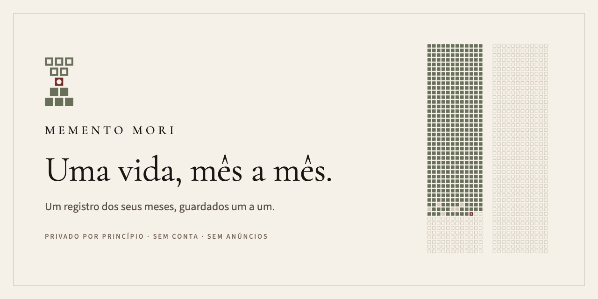
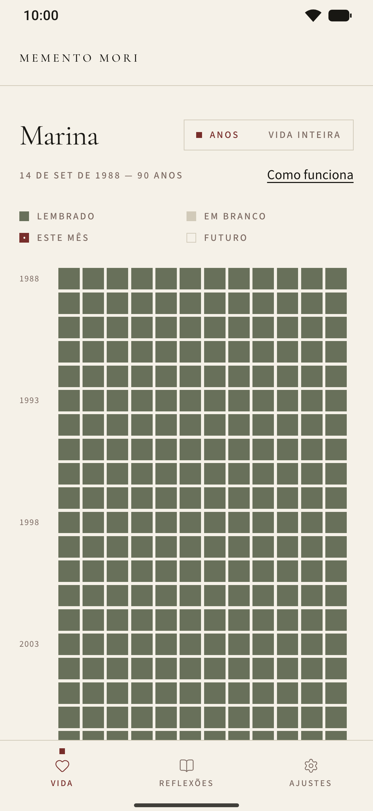
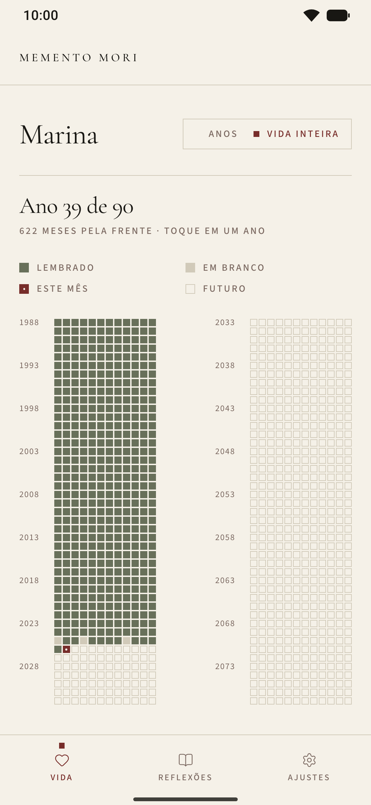
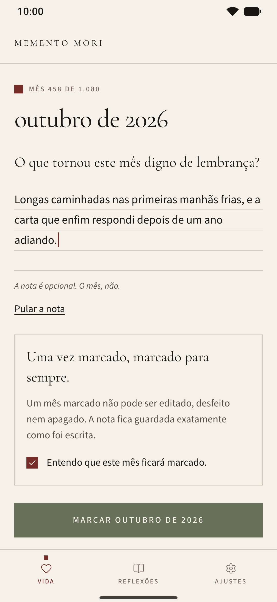
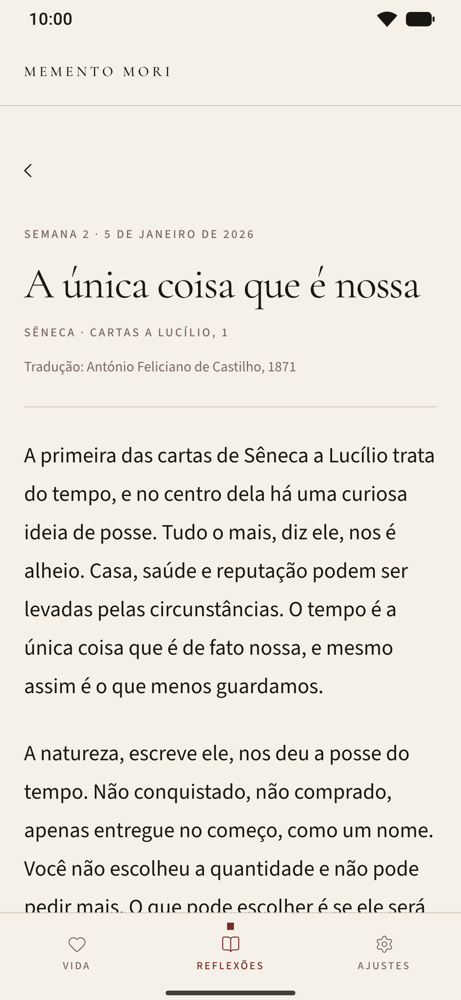

<a href="README.md">English</a> · <b>Português</b>

  

  <i>Um registro dos seus meses, guardados um a um. Marque cada mês uma vez. Guarde o que o tornou digno de lembrança.</i>

  <a href="https://github.com/gabrielsanttana/mementomori/releases/latest"><b>Baixar a prévia (APK)</b></a>
  &nbsp;·&nbsp; Android 7.0 ou mais recente &nbsp;·&nbsp; Em breve no Google Play
   
  <a href="https://gabrielsanttana.github.io/mementomori/pt-br/">gabrielsanttana.github.io/mementomori/pt-br</a>

<table align="center">
  <tr>
    <td align="center"> ANOS</td>
    <td align="center"> VIDA INTEIRA</td>
    <td align="center"> MARCAR UM MÊS</td>
    <td align="center"> A REFLEXÃO DA SEMANA</td>
  </tr>
</table>

---

## Por que "memento mori"

*Memento mori* quer dizer, em latim, "lembre-se de que você vai morrer". Pode soar sombria à
primeira vista, mas nunca foi feita para assustar. Era um jeito de trazer foco ao presente momento.
A ideia é mais antiga que a expressão: Sócrates, no *Fédon* de Platão, chamou a filosofia de uma
preparação para a morte, e os estoicos depois dele fizeram dela um exercício diário.

Sêneca, nas cartas e em *Sobre a brevidade da vida*,
defendeu que a vida é longa o bastante para quem sabe usá-la; Marco Aurélio voltou a esse
pensamento muitas vezes nas *Meditações*; Epicteto o ensinava aos alunos sem rodeios:

> *"Tenha diante dos olhos, todos os dias, a morte, o exílio e tudo o mais que parece terrível,
> mas sobretudo a morte: assim você jamais pensará em nada mesquinho, nem desejará coisa alguma em
> excesso."*
>
> Epicteto · Manual, 21 · Tradução nossa, a partir da versão inglesa de George Long, 1877

O pensamento seguiu vivo na contemplação cristã ("Ensina-nos a contar os nossos dias"), nas
naturezas-mortas de *vanitas* que punham uma ampulheta ao lado das coisas boas da mesa, e em
Montaigne, que desejava que a morte o encontrasse "plantando as minhas couves". O sentido é sempre
o mesmo: lembrar que o tempo acaba é um modo de dar valor a ele, não de temê-lo.

**Uma vida numa página.** Contada em dias, uma vida passa de trinta mil. Contada em meses, noventa
anos são 1.080 quadrados, poucos o bastante para ser vistos por inteiro. Calendários da vida como
"Your Life in Weeks", de Tim Urban (Wait But Why, 2014), mostraram quanto essa única imagem pode
dizer; o Memento Mori a desenha em meses, para que cada quadrado guarde uma marca e algumas
palavras, escritas uma única vez.

Salmo 90:12 na tradução de João Ferreira de Almeida, Edição Revista e Corrigida, 1904. Montaigne em tradução nossa.

<!-- OPCIONAL, para Gabriel: uma ou duas frases suas sobre por que você fez este app. Pode deixar de fora. -->

**O que ele não é**

- **Não é uma contagem regressiva.** Nada faz tique-taque, e nada é previsto. A grade simplesmente
  termina na extensão que você escolher.
- **Não é um rastreador de hábitos.** Sem sequências, sem pontos, sem metas a cumprir.
- **Não se apoia na culpa.** Um mês em branco é só um mês em branco. Ninguém o cobra, e ele
  continua aberto.

É um jeito tranquilo de perceber o tempo que lhe é dado e de guardar o que tornou cada mês digno de lembrança.

## A grade

Sua vida, desenhada em meses: uma linha para cada ano, doze quadrados por linha. A grade começa no
seu nascimento e termina na extensão que você escolher, noventa anos a menos que você defina outra.
Cada quadrado é um mês da sua vida, e um deles é sempre o mês que você está vivendo agora.

| | Mês | O que significa |
| :-: | --- | --- |
|  | **Lembrado** | Um mês que você marcou, com ou sem nota. Os meses anteriores ao início do seu registro são preenchidos quando você o abre. |
|  | **Em branco** | Um mês passado que ficou sem marca. Ele continua aberto; você pode voltar a ele quando quiser. |
|  | **Este mês** | O mês em que você está, à espera de ser marcado. |
|  | **Futuro** | Os meses que ainda virão. |

## Marcar um mês

Uma vez por mês, abra o quadrado do mês em que você está e responda a uma única pergunta: *o que tornou este mês digno de lembrança?* Guarde uma nota curta ou marque o mês sem ela. A nota é
opcional. O mês, não.

**Escrito uma só vez, a tinta.** Um mês marcado não pode ser editado depois, e é essa a intenção.
Você faz uma pausa, escolhe pelo que este mês deve ser lembrado e escreve uma vez, como um
lançamento feito a tinta num livro; saber que não existe rascunho é o que dá peso a essas poucas
palavras. O que fica é o que você escolheu guardar naquele momento, não uma versão polida depois.
Uma vez marcado, marcado para sempre.

## Duas vistas

- **Anos.** O quadro abre nos seus anos, uma linha de cada vez, com o ano atual à vista e uma
  contagem discreta embaixo: lembrados, em branco, ainda pela frente.
- **Vida inteira.** Todos os anos numa só tela, sem rolar, sob uma única linha que diz onde você
  está, como "Ano 39 de 90". Faça o gesto de pinça na vista de anos para chegar lá e toque num ano
  para abri-lo.

## A reflexão da semana

Alguns minutos para o que dá sentido aos meses. Cinquenta e três textos curtos, um
para cada semana do ano, sobre o tempo, a atenção e a gratidão, de Sêneca, Marco Aurélio, Epicteto,
Montaigne, Emerson, Thoreau, Whitman, Rilke, Tagore, Emily Dickinson, Tolstói e outros. Cada um
parte de uma passagem, traz uma citação em destaque e termina com uma pergunta para levar pela
semana. As semanas passadas ficam no acervo.

> **Semana 2 · A única coisa que é nossa**
>
> *"Meu Lucílio, tudo mais é alheio; só o tempo é que é nosso."*
>
> Sêneca · Cartas a Lucílio, 1 · Tradução de António Feliciano de Castilho, 1871
>
> O que tomou as suas horas ultimamente que você não escolheria dar de novo?

## Lembretes

Dois lembretes discretos, se você quiser: um semanal, no dia e no horário que você escolher (*A
reflexão da semana*), e um mensal, no último dia de cada mês, no horário que você escolher (*Um mês para lembrar. Marque o que o tornou digno de lembrança.*). Os dois são agendados no próprio
celular, e os dois podem ser desligados em Ajustes.

## Privado por princípio

Este registro é seu. Ele fica no seu celular, e o app nunca o envia a lugar nenhum.

**Sem conta · Sem login · Sem sincronização · Sem rastreamento · Sem anúncios**

- **Um celular novo.** Seu registro faz parte do próprio backup do Android, então configurar um
  celular novo a partir desse backup leva os seus meses junto.
- **Uma cópia só sua.** *Exportar meu acervo* gera um arquivo simples com todos os meses e notas;
  *Restaurar de um arquivo* o traz de volta.
- **Apagado quando você quiser.** *Apagar este aparelho* remove todos os meses e todas as notas de
  uma vez.

Leia a [política de privacidade](https://gist.github.com/gabrielsanttana/80c33d4d604d0b20329192adfdc450f5#file-memento-mori-privacy-policy-pt-br-md).

## Instalar a prévia

O Memento Mori está a caminho do Google Play. Enquanto isso, uma versão prévia é
distribuída como APK. Ela precisa do Android 7.0 ou mais recente.

1. No seu celular Android, abra a
   [versão mais recente](https://github.com/gabrielsanttana/mementomori/releases/latest) e baixe
   o arquivo terminado em `.apk`.
2. Abra o arquivo baixado. O Android vai pedir permissão para instalar apps desta fonte: ative
   **Permitir desta fonte** para o navegador ou o gerenciador de arquivos e volte. Se o aviso não
   aparecer, procure em Configurações › Apps › Acesso especial a apps › **Instalar apps
   desconhecidos**.
3. Toque em **Instalar**. O Google Play Protect pode pedir que você confirme um app que ele ainda
   não conhece.
4. Abra o **Memento Mori Preview**, escolha **Português** na tela de idioma, informe seu nome e sua
   data de nascimento e comece. A data de nascimento é definida uma vez e não pode ser alterada
   depois.

A prévia é um app à parte (`com.gabriel.mementomori.preview`), então pode ficar ao lado da versão
do Google Play quando ela chegar.

## Perguntas

**Existe versão para iPhone?** 
Ainda não. A primeira versão é só para Android.

**Onde fica guardado o meu registro?** 
Somente no seu celular, num banco de dados local: seu nome, sua data de nascimento, a extensão da
grade, suas escolhas de lembrete e cada mês que você marca, com a sua nota. Nada é coletado,
vendido, compartilhado ou analisado.

**O que acontece quando eu troco de celular?** 
Se o backup do celular estiver ativado, configurar o aparelho novo a partir dele traz os seus meses
junto. Para fazer a mudança à mão, use *Exportar meu acervo* em Ajustes e depois *Restaurar de um
arquivo* na tela de boas-vindas do celular novo.

**Como passo da prévia para a versão do Google Play?** 
São apps separados e podem ficar instalados lado a lado. Na prévia, use *Exportar meu acervo*.
Instale o Memento Mori pelo Google Play e escolha *Restaurar de um arquivo*. Quando os seus meses
estiverem lá, a prévia pode ser desinstalada.

**Posso mudar um mês depois de marcá-lo?** 
Não, e de propósito. Um mês é marcado uma única vez, como um registro escrito a tinta: o que fica é
o que você escolheu lembrar naquele momento. Você pode abri-lo quando quiser e lê-lo exatamente
como escreveu.

**E se eu esquecer um mês?** 
Ele fica em branco e continua aberto. Você pode voltar e marcá-lo quando quiser; nunca é tarde para
lembrar.

**O app está em português?** 
Sim. Ele fala português e inglês: o idioma é escolhido na primeira abertura e pode ser mudado
depois em Ajustes. As reflexões também têm edição em português.

---

   
  
    <a href="https://gist.github.com/gabrielsanttana/80c33d4d604d0b20329192adfdc450f5#file-memento-mori-privacy-policy-pt-br-md">Política de privacidade</a>
    &nbsp;·&nbsp;
    <a href="mailto:santana.sw.solutions@gmail.com">santana.sw.solutions@gmail.com</a>
  
   
  Um projeto pessoal de Gabriel Santana. Feito com Expo e React Native em TypeScript, com SQLite via Drizzle; tudo roda no celular.

